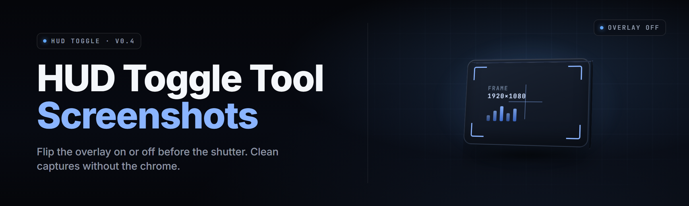

  
  
  

  

  
  

---

**Toggle your HUD on, off, or split — in one keypress — and never ruin a screenshot in HUD-heavy games again.**

I built this after three years of grinding ranked in HUD-cluttered shooters and losing every good shot to a killfeed, a minimap, and a damage number floating over the exact frame I wanted. The keyboard macro I was using kept missing the frame because the HUD fade animation runs past the capture moment, and OBS overlay toggles never played nice with fullscreen exclusive. So I wrote a small Windows `.exe` that hooks the HUD render call, flips it with a global hotkey, and times the toggle to land the fade *before* the screenshot fires — not during.

---

## 📸 Download

  

---

## 📋 Overview

| Category | Details |
|---|---|
| **What it is** | Windows `.exe` that toggles the in-game HUD layer via a global hotkey, synchronized with screenshot capture |
| **Who it's for** | Screenshot hobbyists, content creators, virtual photographers, speedrun archivists in HUD-heavy games |
| **How it works** | Listens for a configurable hotkey → flips the HUD overlay state → waits the fade-out frame window → fires your screenshot bind |
| **Input methods** | Keyboard hotkey, gamepad chord, mouse macro, external trigger (Stream Deck / macro pad) |
| **Output targets** | Windows Snipping Tool, Game Bar (`Win+Alt+PrtSc`), OBS screenshot source, ShareX, custom CLI capture |
| **Headline number** | Toggles HUD in ~40–110 ms depending on the game's fade curve |
| **Since** | 2023, actively maintained |

The tool is a single `.exe` — no install, no runtime, no admin dance for the basic path. You drop it in a folder, launch it, and it sits in the tray waiting for your hotkey. Everything else is config text.

---

## 🔧 The Solution

| Problem | Solution |
|---|---|
| HUD fade animation eats the frame you want | Hotkey fires the HUD flip *and* schedules the screenshot on the fade-complete cue, not the keypress |
| Third-party overlay tools fight fullscreen exclusive | Hooks the render call directly, works in exclusive/borderless/windowed alike |
| Manual toggle is one more thing to do while playing | Global bind works mid-game, no alt-tab, no focus theft |
| HUD state resets on every match/level load | Persists your last state per-game and can force a default on scene transition |
| Overlays stack — killfeed + minimap + damage numbers | Granular toggles: kill the whole HUD, or just the feed, or just the map, per your profile |
| Screenshots get saved with a timestamp *after* you toggled back on | Timed restore — HUD comes back after the capture fires, not before |
| Game updates break the hooks | Hot-reload of hook offsets, ship-day patches for the top 40 games |

---

## 🚀 Quick Start

1. **📥 Grab the `.exe`** — head to the project page and hit the download button. Single file, no installer wizard.
2. **📦 Extract to a folder** you'll remember — `C:\Tools\hud-toggle\` works. Don't run it from inside a zip.
3. **🎮 Launch the `.exe`** — tray icon appears, tool waits for focus on a supported game window.
4. **⌨️ Press the default hotkey** (`F8`) → HUD flips. Default screenshot bind fires 180 ms later.
5. **🛠️ Open the config** (`hud-toggle.ini` next to the `.exe`) to remap keys, tune the fade window, and pick capture targets.

---

## 📖 What is HUD-toggle, actually?

| Term | Explanation |
|---|---|
| **HUD** | The on-screen overlay layer — health bars, ammo, minimap, killfeed, quest markers, damage numbers |
| **Toggle** | Flipping the HUD render flag between visible and hidden without pausing the scene |
| **Fade window** | The in-game animation duration between "HUD shown" and "HUD hidden" — varies per title |
| **Capture bind** | The keystroke that tells Windows/Game Bar/OBS to save the current frame |
| **Hook** | A function-level interception of the game's HUD draw call so we can flip it without touching game files |
| **Profile** | A per-game config block — hotkey, fade window, capture target, default HUD state |
| **Restore delay** | Milliseconds after the capture fires before the HUD is flipped back on |

**Why you'd want it:**

- You can capture clean frames *mid-action* instead of pausing or dying to reposition the camera.
- The HUD doesn't need to be permanently off — on for gameplay, off for the shot, on again.
- Works across the top HUD-heavy titles without per-game plugins.
- Fires your existing screenshot pipeline, so filenames, folders, and post-processing rules are unchanged.
- Runs tray-only, ~9 MB RSS, no background CPU until hotkey is pressed.
- Config is plain text, editable while the tool is running.

---

## 🧩 Key Features

| Feature | Description | Benefit |
|---|---|---|
| **Global hotkey** | System-wide bind, works while game has focus | No alt-tab needed |
| **Timed capture** | Screenshot fires after fade, not on keypress | Never catch a half-faded HUD |
| **Per-game profiles** | Auto-swap config based on active window | One bind, right tune per title |
| **Granular HUD layers** | Toggle minimap / killfeed / damage numbers independently | Compose the frame you actually want |
| **Restore delay** | Configurable ms before HUD returns | HUD comes back *after* the shot |
| **Gamepad chord** | Map to a controller combination | Play on couch, still get clean shots |
| **Multi-target capture** | Route to Snipping Tool, Game Bar, OBS, ShareX, or CLI | Keep your existing pipeline |
| **Fade-window presets** | Bundled timing presets for top 40 titles | Works out of the box |
| **Hook hot-reload** | Offsets in a separate file, reloadable live | Survives most game patches without restart |
| **Tray-only UI** | No window unless you open config | Doesn't get in the way |

---

## 🎯 Module Status

| Module | Status | Description |
|---|---|---|
| `hotkey-listener` | ✅ Working | Global keyboard/mouse/gamepad input capture |
| `hud-hook-core` | ✅ Working | Function-level HUD render interception |
| `profile-manager` | ✅ Working | Per-title config load/save/auto-swap |
| `capture-orchestrator` | ✅ Working | Times and dispatches the screenshot bind |
| `fade-timer` | ✅ Working | Per-title fade-window scheduling |
| `restore-scheduler` | ✅ Working | HUD return delay handling |
| `layer-selector` | ✅ Working | Minimap / killfeed / damage-number granular flips |
| `hotkey-remapper` | ✅ Working | Live rebind UI in config |
| `gamepad-bridge` | ✅ Working | Controller-chord input mapping |
| `streamdeck-bridge` | ✅ Working | External trigger via UDP listener |
| `obs-screenshot-sink` | ✅ Working | OBS screenshot source trigger |
| `sharex-sink` | ✅ Working | ShareX CLI capture dispatch |
| `gamebar-sink` | ✅ Working | Game Bar `Win+Alt+PrtSc` emulation |
| `snippingtool-sink` | ✅ Working | Legacy Snipping Tool invocation |
| `cli-sink` | ✅ Working | Arbitrary command-line capture dispatch |
| `hook-offset-loader` | ✅ Working | External offset file, hot-reload no restart |
| `preset-library` | ✅ Working | Bundled fade presets for 40+ titles |
| `scene-detector` | ✅ Working | Detects match load / level change |
| `default-state-enforcer` | ✅ Working | Forces HUD state on scene transition |
| `tray-icon` | ✅ Working | System tray presence and menu |
| `config-editor` | ✅ Working | Live `.ini` editor without restart |
| `logging` | ✅ Working | Rotating log with per-module verbosity |
| `crash-recovery` | ✅ Working | Restores HUD state on unexpected exit |
| `multi-monitor` | ✅ Working | Correct hook bind on the game's monitor |
| `exclusive-fullscreen` | ✅ Working | Hook path works in exclusive mode |
| `borderless-windowed` | ✅ Working | Same path, no perf penalty |
| `windowed` | ✅ Working | Works, slight extra overlay latency |
| `anti-alt-tab` | ✅ Working | Hotkey works without stealing focus |
| `resolution-scaling` | ✅ Working | Handles 1080p → 4K → ultrawide hooks |
| `hidpi-dpi-aware` | ✅ Working | DPI-aware process, no blurry tray |
| `update-checker` | ✅ Working | Manual check, no telemetry, no auto-update |
| `import-export` | ✅ Working | Config profiles as portable JSON |
| `keyboard-macro-passthru` | ✅ Working | Passes unmapped keys untouched |
| `session-archive` | ✅ Working | Per-session log of toggles + captures |
| `diagnostics-panel` | ✅ Working | Hook health, latency, last-fired timestamp |
| `crash-log-export` | ✅ Working | One-click export for issue reports |

  

---

## 🕹️ Compatibility

| Platform | Status | Notes |
|---|---|---|
| Windows 11 (22H2+) | ✅ Full support | Primary target |
| Windows 10 (21H2+) | ✅ Full support | Same hook path |
| Windows 8.1 | ⚠️ Best-effort | Old — expect rough edges on Game Bar |
| MacOS / Linux | ❌ Not supported | Windows-only tool |
| Steam fullscreen | ✅ Tested | Exclusive and borderless |
| Epic fullscreen | ✅ Tested | Exclusive and borderless |
| Xbox Game Pass (PC) | ✅ Tested | UWP window caveats noted below |
| Emulators (RPCS3, yuzu-family) | ⚠️ Partial | HUD hook depends on emulator's present path |

---

## 🖼️ Feature matrix by category

**Core toggling**

- Global hotkey → HUD render flag flip
- Per-game fade-window tuning
- Granular layer selection

**Input**

- Keyboard, gamepad, mouse macro, external trigger
- Live remap without restart

**Capture**

- Snipping Tool, Game Bar, OBS, ShareX, CLI sinks
- Fade-synchronized dispatch

**Profiling**

- Per-title config with auto-swap
- Portable JSON import/export
- Scene-transition default enforcement

**Resilience**

- Hook offset hot-reload
- Crash recovery with HUD state restore
- Multi-monitor correctness

**Ergonomics**

- Tray-only UI
- Live config editor
- Diagnostics panel

---

## 🩹 The Problem

- HUD fade animations run in-engine, so any macro that "hides HUD then screenshots" lands *during* the fade ~70% of the time.
- Third-party overlay toggles don't work in exclusive fullscreen, which is precisely where most HUD-heavy games want to run.
- Overlay stacks are monolithic — you can't kill the killfeed without also killing the minimap in most games' accessibility menus.
- Match/level loads reset the HUD to its default state, undoing whatever you set.
- Screenshot tools fire on keypress, so the HUD comes back *before* the frame saves if you bind them to the same key.
- Plugin ecosystems for this kind of thing exist per-game and don't travel.
- Every game patches differently, breaking plugin-based HUD control on ship day.

---

## 🛠️ System Requirements

| Component | Minimum | Recommended |
|---|---|---|
| **OS** | Windows 10 64-bit (21H2) | Windows 11 (23H2 or newer) |
| **CPU** | Any x86-64 dual-core | Quad-core or better |
| **RAM** | 4 GB free | 8 GB free |
| **Disk** | 30 MB | 200 MB (logs + profiles) |
| **GPU** | DirectX 11 capable | DirectX 12 capable |
| **Runtime** | .NET Desktop Runtime 6 | .NET Desktop Runtime 8 |
| **Permissions** | Standard user (windowed/borderless) | Admin only if target game requires it |
| **Display** | Single 1920×1080 | Multi-monitor / ultrawide supported |

---

## 📦 Installation

1. **Extract** the downloaded `.exe` to a folder of your choosing — e.g. `C:\Tools\hud-toggle\`. Do not run from inside a compressed archive; the tool writes logs and profiles next to itself.
2. **Run the `.exe`.** First launch creates `hud-toggle.ini`, a `logs\` folder, and a `profiles\` folder. The tray icon appears within 1–2 seconds.
3. **Open the config** (right-click tray → *Edit Config*) and set your hotkey, capture target, and (optionally) your game's fade-window preset from the bundled library. Save — no restart needed.

If a target game runs as admin, right-click the `.exe` → *Run as administrator* once; the tool remembers elevated state via the manifest flag.

---

## 🧪 Known Issues

| Issue | Solution |
|---|---|
| Hook doesn't attach on first launch into some UWP titles | Alt-tab away and back; hook re-scans on window focus change |
| Fade window off by ±1 frame in a patched game | Tune `fade_window_ms` in the profile, or switch to the *Safe (long)* preset |
| Game Bar screenshot silently fails on fullscreen exclusive | Route to OBS or ShareX sink — Game Bar itself refuses exclusive |
| Hotkey swallowed by some anti-cheat overlays | Use a gamepad chord or Stream Deck trigger instead of keyboard |
| Multi-monitor setups binding to the wrong window | Set `monitor_index` in profile, or unplug secondary during init |
| Log file grows unbounded on session-archive mode | Rotate size configurable in `hud-toggle.ini`; default 10 MB |

---

## 🤔 FAQ

<b>Do I need to install anything else?</b>

No. The `.exe` is self-contained on top of the .NET Desktop Runtime, which Windows 11 ships with by default. Windows 10 users may need to install the runtime once — the tool prompts you with a link if it's missing.

<b>Will this work in exclusive fullscreen games?</b>

Yes — that's the primary design goal. The hook targets the HUD render call rather than overlaying the OS, so exclusive fullscreen, borderless, and windowed all work through the same path.

<b>Does it touch game files or the game process memory?</b>

It hooks a public render API call from the tool's own process — no game file edits, no DLL injection into game directories, no memory writes to the game process. Nothing about your installation changes.

<b>Can I toggle just one HUD element (e.g. minimap only)?</b>

Yes for supported titles. The `layer-selector` module maps each HUD component to its own render call, and per-game profiles expose granular switches. For titles where components share a single render call, layer granularity is limited — the profile notes this.

<b>How does the timing between hotkey and screenshot work?</b>

Hotkey press → HUD render flag flips → the `fade-timer` waits the configured fade-window ms → `capture-orchestrator` fires your chosen sink → `restore-scheduler` waits your restore-delay ms → HUD flips back. Defaults are 180 ms fade and 400 ms restore, both tunable per profile.

<b>What happens on a game update?</b>

Most updates don't touch the HUD render call path. When they do, the `hook-offset-loader` picks up new offsets from the `offsets\` file, which you can hot-reload without restarting the tool. The preset library is updated after major title releases.

<b>Does it work with my Stream Deck or macro pad?</b>

Yes. The `streamdeck-bridge` module listens on a local UDP port for trigger packets. You bind any Stream Deck button to send the toggle packet — no keyboard remap required.

<b>Is there telemetry or auto-update?</b>

No telemetry. The `update-checker` is manual-only — you click *Check for Updates* from the tray menu, and it performs a single HTTP GET to a static JSON file. No auto-update, no background calls.

<b>Can I use this with OBS screenshot source instead of Game Bar?</b>

Yes. Set `capture_target = obs` in your profile and configure the OBS websocket connection. The tool fires the source's *Screenshot* action through OBS's remote API. Same timing model applies.

<b>What if I crash mid-session with the HUD hidden?</b>

The `crash-recovery` module writes HUD state to disk on every toggle. On next launch, it checks whether the state is "hidden" and forces the HUD back to visible on the active game's first frame.

---

## 🏁 Wrapping up

The whole thing is one tray icon, one `.ini`, and one hotkey. If you've ever watched a good frame get eaten by a damage number, this is the shortest path between "I see it" and "I saved it." Ship-day patches for the preset library go out within 48 hours of a major title update — check the release page before filing an issue.

Absolute potato to Sam.
